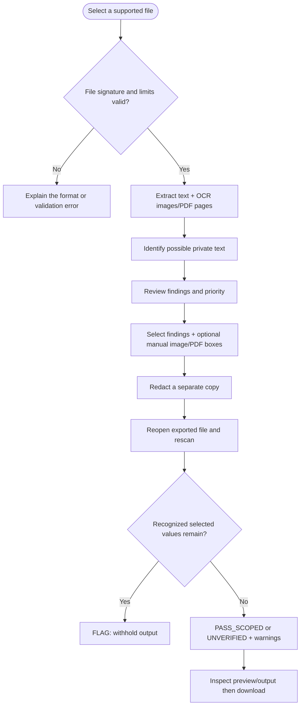
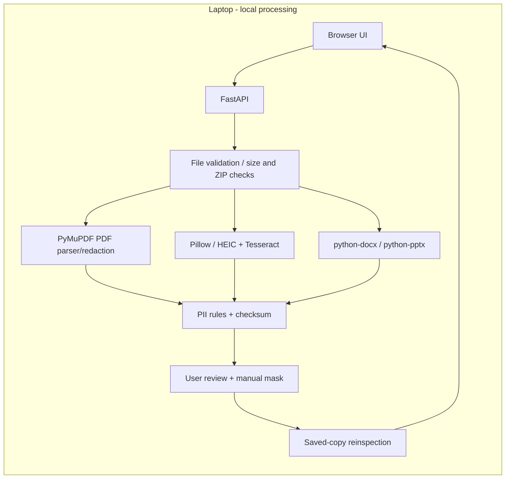

<div align="center">

# 🛡️ ShareShield

### Detect · Review · Redact · Verify · Share

**A local-first privacy review prototype for documents, screenshots and photos.**

**Mini-project demonstration: 28 October 2026** · **Current development branch: `backend/pdf-redaction-verification`**

</div>

---

## What ShareShield does

ShareShield runs a browser interface against a **local FastAPI service on your laptop**. Upload a supported file, inspect potential private identifiers, approve selected redactions, draw manual boxes over overlooked details in images or PDFs, then check a new output file and download it.

The engine looks for **email addresses, Indian mobile-number candidates, PAN-format identifiers, checksum-valid Aadhaar-format candidates and common UPI handles**. The matching rules indicate *possible private information*, not verified identities. No automatic detector can guarantee complete privacy protection.

### Supported content

| File | Detection | Export |
| --- | --- | --- |
| JPG/JPEG, PNG, HEIC/HEIF, WEBP, BMP, TIFF | OCR of visible text | Flattened PNG |
| Searchable/scanned PDF | Native text extraction and full-page OCR | Redacted PDF |
| Word DOCX | Editable paragraphs, tables, headers/footers | Modified DOCX |
| PowerPoint PPTX | Editable slide text, shapes and tables | Modified PPTX |
| UTF-8 TXT | Text pattern matching | Modified TXT |

Older `.doc` files, video, archives, audio, spreadsheets, encrypted PDFs and arbitrary formats are not supported. Images and PDFs support visual before-and-after previews and manual masking; Office and TXT outputs must be inspected in their respective editors.

## User workflow



**PASS_SCOPED** means selected recognized values were not found by supported rechecks, **not** that all personal data has been removed. **UNVERIFIED** warns when checks are insufficient (for example, manual-only boxes). Read warnings and inspect the exported file before sharing.

## Planned / current architecture



## Quick start on macOS

Stop any existing server with **Control+C**, then:

```bash
cd ~/Desktop/ShareShield
git switch backend/pdf-redaction-verification
git pull origin backend/pdf-redaction-verification
source .venv/bin/activate
brew install tesseract
python -m pip install -r backend/requirements.txt
python -m pip install pytest httpx
python -m pytest backend/tests -v
python -m uvicorn backend.app:app --host 127.0.0.1 --port 8000
```

Open **http://127.0.0.1:8000/** for the upload interface or **http://127.0.0.1:8000/docs** for API debugging. Homebrew, HEIC decoding or dependency availability on older macOS hardware may require adaptation.

## Limitations and responsible use

- Text-only detection: handwriting, faces, visual IDs without recognizable text, obscure layouts and false negatives remain possible.
- Redaction review is user-controlled, but DOCX/PPTX replacements may change text formatting and miss hidden structures.
- Not all metadata, comments, revisions, embedded files, attachments, annotations or scripts are sanitized.
- Test only with synthetic or explicitly authorized data. Never commit real documents or secrets to this public repository.
- Run the local server on **127.0.0.1**, never a publicly accessible address, during development.
- PyMuPDF has AGPL/commercial licensing terms that require review before distribution or commercialization.

The prototype has automated tests on GitHub Actions, but **full end-to-end QA on the target Mac, including HEIC handling, is still required**.

## Documentation

- [Backend details, installation and API](backend/README.md)
- [Prerequisites](docs/PREREQUISITES.md)
- [Project scope](docs/PROJECT_SCOPE.md)
- [Contributing](CONTRIBUTING.md)
- [Security policy](SECURITY.md)
- [IP and licensing](docs/IP_AND_LICENSING.md)
- [Pull request for the updated prototype](https://github.com/krutharth-dev/ShareShield/pull/1)

---

<div align="center">

**ShareShield · Malnad College of Engineering**

*Detect. Redact. Verify. Then Share.*

</div>
