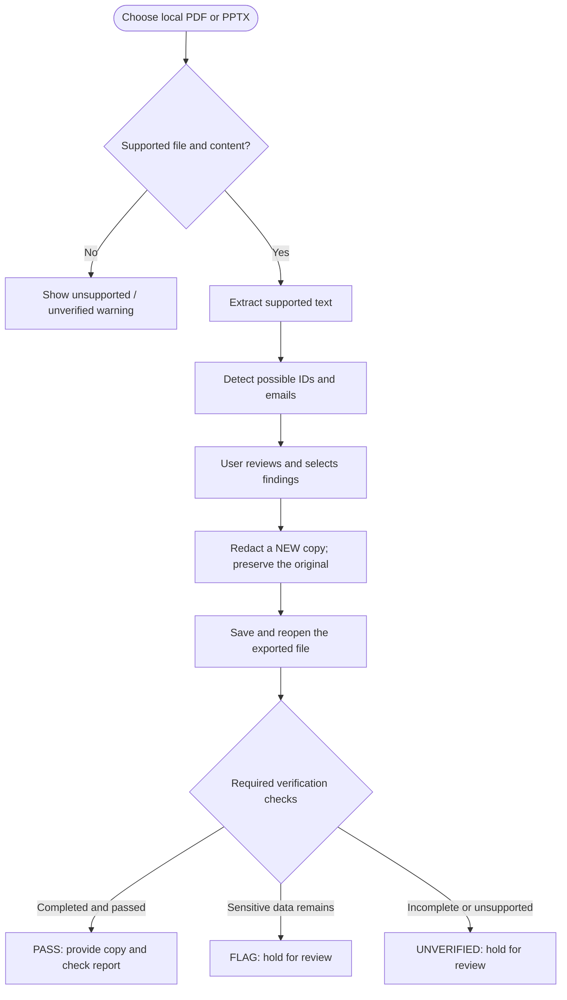
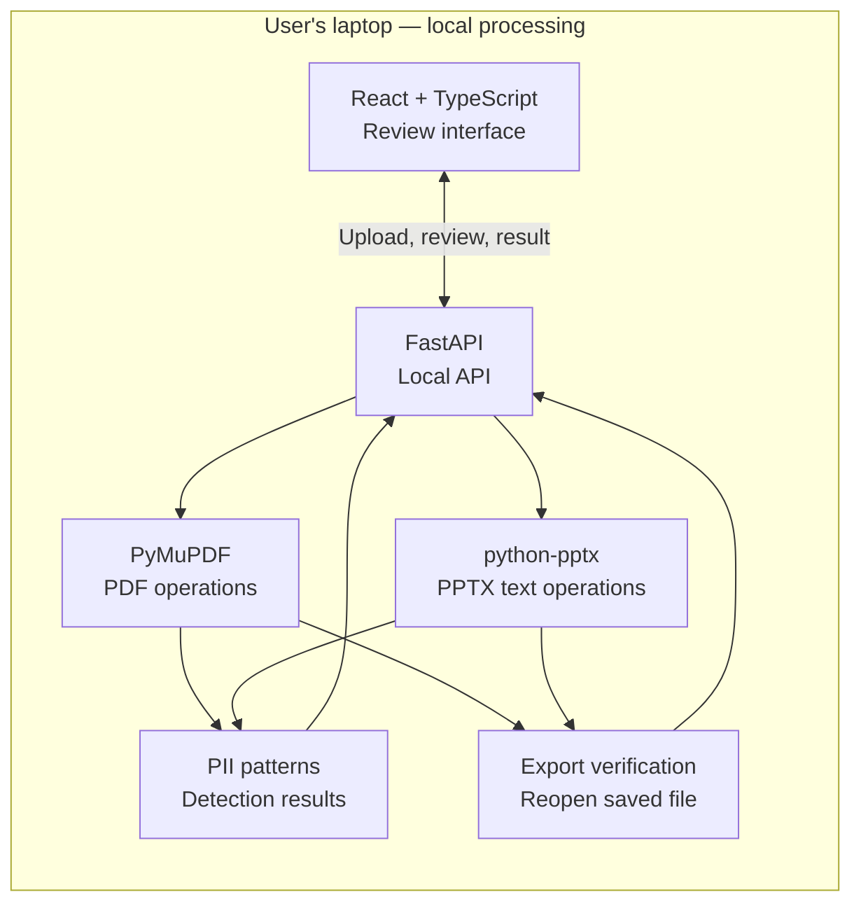

# 🛡️ ShareShield

### Detect. Redact. Verify. Then Share.

**A local-first system for sensitive-document detection, user-controlled redaction, and post-export privacy checks.**

**🟡 Planning & setup** · **🔒 Private development** · **📅 Mini-project demo: 28 October 2026**

---

## Overview

ShareShield is designed to help users **check documents before sharing them**. It aims to detect selected sensitive information, let users review and remove it from a new copy, and then **reopen the exported file** to check whether the selected information is still present.

> **Why verification matters:** A black rectangle can make a student ID look hidden while its text remains searchable or copyable in a PDF. ShareShield focuses on checking the *saved file*, not just trusting how the preview looks.

**Current status:** This repository contains project documentation and preparation material. Implementation starts **19 October 2026**. No working application, measured accuracy, or security certification is claimed yet.

## At a glance

| | Mini project — October 2026 | Major project — future direction |
| --- | --- | --- |
| **Experience** | Local browser-based document review | Android, iOS and web experiences |
| **Input** | Searchable English PDFs; text-based PPTX as an extension | More documents, screenshots and images |
| **Detection** | Selected ID and email patterns | Patterns, contextual recognition, OCR and visual detection |
| **Redaction** | PDF content redaction; editable PPTX text replacement | Wider document and image support |
| **Verification** | Reopen saved output and run documented checks | Expanded text, visual and file-structure checks |
| **Sharing** | User downloads a reviewed copy | User-initiated system share sheets and authorized integrations |

**Delivery priority:** A dependable **PDF workflow** comes first. PPTX support is planned for the mini project but is **subject to testing** and must not jeopardize the PDF demonstration.

## Mini-project workflow

The following diagram describes the **planned** interaction, not a completed feature.

**PASS is scoped, not absolute.** It means no selected sensitive value was found by the required checks **actually completed**. A check that fails to run, or content that cannot be reliably inspected, must not be called safe.

## Planned architecture

The mini project is designed to run **locally on one laptop during the demo**. Its browser frontend communicates with a local backend; original documents do not need to be uploaded to a public cloud.

### Intended stack

| Layer | Planned tools | Purpose |
| --- | --- | --- |
| User interface | React, TypeScript, Vite | Upload, findings review, results |
| Local service | Python, FastAPI | File handling and coordination |
| PDF | PyMuPDF | Text extraction and true content redaction |
| Presentations | python-pptx | Editable text extraction and replacement |
| Detection | Configurable patterns / regular expressions | Initial ID and email detection |
| Verification | Independent saved-file checks | PASS / FLAG / UNVERIFIED reporting |
| Collaboration | Git + private GitHub repository | Version history and reviews |

Tool choices may change following compatibility and license review. **PyMuPDF's AGPL/commercial licensing options require evaluation before distribution.**

## Supported scope and limitations

| Scenario | Mini-project target |
| --- | --- |
| Searchable English PDF containing fictional ID/email | **Core target** |
| Editable text in a modern `.pptx` | **Planned extension** |
| A PDF where a black shape merely covers copyable text | **Illustrative leak test** |
| Scanned/image-only PDFs or text embedded in pictures | Not part of the initial guarantee |
| Complex PPTX objects, speaker notes and embedded documents | Not automatically considered verified |
| OCR, face redaction, multilingual support | Future work |
| Monitoring every WhatsApp or Gmail upload silently | **Not supported** by an unrestricted third-party mobile app |

Unrecognized formats, unsupported content and incomplete verification must be surfaced clearly to users rather than reported as passing.

## Roadmap

| When | Planned deliverable |
| --- | --- |
| **16–18 Oct 2026** | Repository setup, prerequisites and fictional test cases |
| **19–22 Oct** | Frontend, local API, PDF extraction, detection and user review |
| **23–25 Oct** | PDF redaction and export checks; attempt PPTX support |
| **26 Oct** | Test failures, edge cases and documentation |
| **27 Oct** | Stable code freeze, backup and rehearsal |
| **28 Oct** | **Mini-project demonstration** |
| **After the demo** | Mobile architecture, expanded privacy checks, testing and release planning |

### Future major-project vision

ShareShield may evolve into an **opt-in, on-device sharing assistant** for Android and iOS. Users would route files through a supported system sharing workflow, review recommended redactions, verify the exported file, and then choose where to share it.

Native sharing capabilities and third-party integrations are **platform-dependent**. Android and iOS generally do not permit an ordinary application to inspect all WhatsApp, Gmail or other-app uploads invisibly in the background. App permissions and release policies must be evaluated before promising any integration.

## Documentation

| Document | What it covers |
| --- | --- |
| [Prerequisites](docs/PREREQUISITES.md) | Required tools and Mac-specific setup checks |
| [Project scope](docs/PROJECT_SCOPE.md) | Acceptance criteria, milestones and limitations |
| [Contributing](CONTRIBUTING.md) | Branches, pull requests and team workflow |
| [Security policy](SECURITY.md) | Responsible testing and vulnerability handling |
| [IP and licensing](docs/IP_AND_LICENSING.md) | Ownership, dependency obligations and patent considerations |

There are **no app installation commands yet** because implementation has not started. Use the prerequisites document to prepare the development environment.

## Responsible development

- Use **fictional or expressly authorized test data**. Never commit real IDs, private user files, exports, credentials or sensitive logs.
- Preserve original files and produce edited copies separately.
- Report only the checks performed; do not claim universal leak prevention.
- Keep research results evidence-based. **Patentability has not been established**; conduct a prior-art and ownership review before public technical disclosure.

## Rights and licensing

**Private repository · No public software license selected.**

Copyright ownership and redistribution permissions still need clarification among contributors and under any applicable institutional policy. The lack of a `LICENSE` file does **not** authorize public reuse or redistribution. Third-party dependency licenses also require review before commercial release.

For details, read [IP and licensing considerations](docs/IP_AND_LICENSING.md).

---

**ShareShield** · Mini-project prototype in planning · **Malnad College of Engineering**

*Detect. Redact. Verify. Then Share.*

